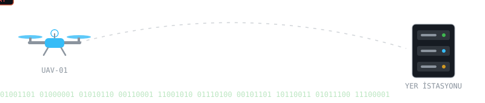
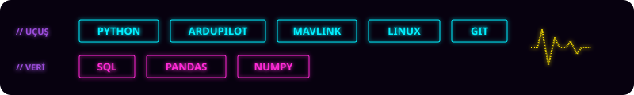

<!-- Üst banner -->

<!-- Yazılıyormuş gibi görünen satırlar -->

  

<!-- Kimlik kartı (terminal) -->

  

<!-- Drone'dan yer istasyonuna veri akışı -->

  

<!-- SQL → tablo → pandas/NumPy analizi -->

  

<!-- Radar + hedef takip ekranı -->

  

<!-- Canlı uçuş veri paneli -->

  

<!-- Kullandıklarım -->

  

<!-- Katkı yılanı: GitHub temasına göre açık/koyu sürüm. Her gün Actions ile üretilir. -->

  <picture>
    <source media="(prefers-color-scheme: dark)" srcset="https://raw.githubusercontent.com/iskenderulkumen/iskenderulkumen/output/github-snake-dark.svg" />
    
  </picture>

