<!-- Yazılıyormuş gibi görünen satırlar -->

  

<!-- Kimlik kartı (terminal) -->

  

<!-- Drone'dan yer istasyonuna veri akışı -->

  

<!-- SQL → tablo → pandas/NumPy analizi -->

  

<!-- Radar + hedef takip ekranı -->

  

<!-- Canlı uçuş veri paneli -->

  

<!-- Kullandıklarım -->

  

<!-- Katkı haritasını tarayan drone: scripts/drone_scan.py her gün Actions ile üretir -->

  

