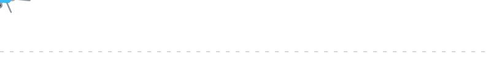

<!-- Üst banner -->

<!-- Yazılıyormuş gibi görünen satırlar -->

  

<!-- Kendi animasyonlu drone'umuz (assets/drone.svg) -->

  

## 🛩️ Hakkımda

- 🚁 Drone ve İHA yazılımları geliştiriyorum
- 🐍 Ana dilim **Python**
- 🎯 Hedef takip algoritmaları üzerinde çalışıyorum
- 🧠 Kendi LLM modelimi yapmayı öğreniyorum
- 🐧 Linux kullanıcısıyım

## 🧰 Kullandıklarım

  

  
  

## 🚀 Projeler

| Proje | Açıklama |
|---|---|
| [ARDUPILOT](https://github.com/iskenderulkumen/ARDUPILOT) | ArduPilot ile drone kontrol çalışmaları |
| [Abra-Projeler-2026](https://github.com/iskenderulkumen/Abra-Projeler-2026) | ABRA yazılım bölümü projeleri |

## 📊 İstatistikler

  
  

## 🐍 Katkı Yılanı

<!-- GitHub temasına göre açık/koyu yılan gösterir. Dosyalar her gün Actions ile üretilir. -->

  <picture>
    <source media="(prefers-color-scheme: dark)" srcset="https://raw.githubusercontent.com/iskenderulkumen/iskenderulkumen/output/github-snake-dark.svg" />
    
  </picture>

<!-- Alt banner -->

